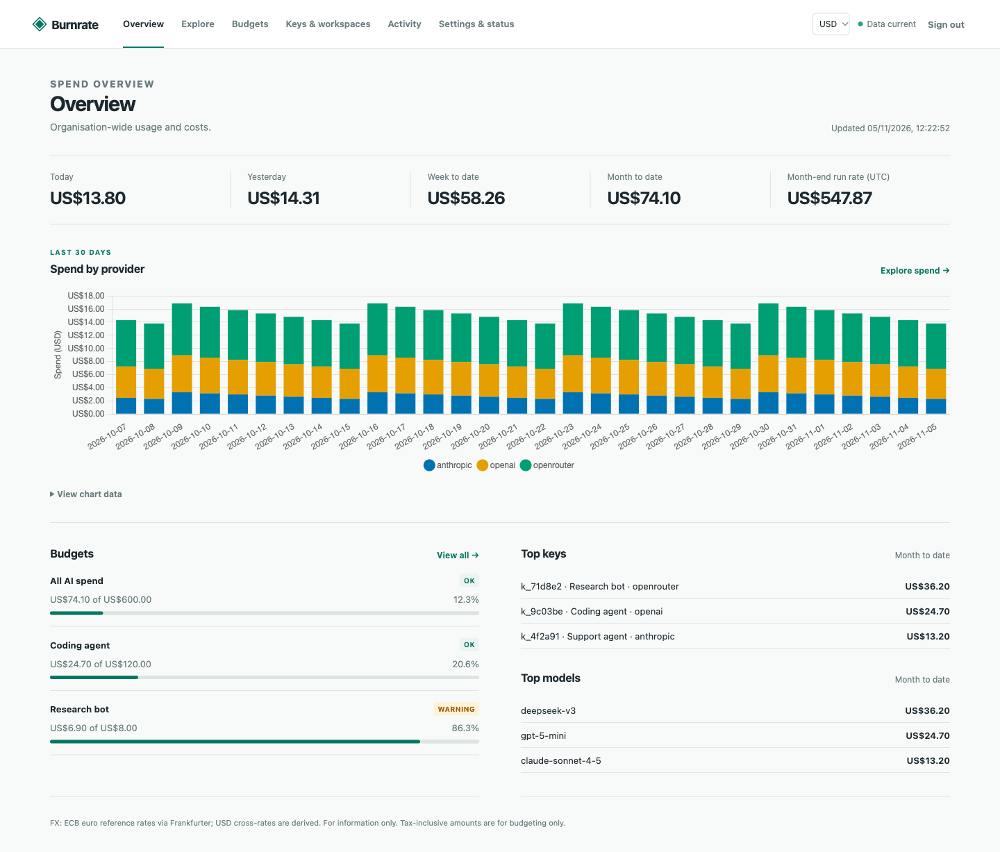

# Burnrate

See what your team spends on AI, across every key, bot and server, with budgets, alerts and an optional auto-stop.

Burnrate is a self-hosted organisation-level AI spend dashboard on Cloudflare Workers, D1 and Cron Triggers. It pulls billing and usage APIs across keys and machines, without routing requests through a gateway or collecting local CLI logs. Your data stays in your Cloudflare account; there is no telemetry.

[](https://deploy.workers.cloudflare.com/?url=https://github.com/ImLukeF/burnrate)



More screenshots: [budgets](docs/screenshots/budgets.png) and [explore](docs/screenshots/explore.png). They use synthetic demo data.

## How it compares

| Approach             | What it sees                                                                    | What you change                       |
| -------------------- | ------------------------------------------------------------------------------- | ------------------------------------- |
| Local log readers    | One machine's coding-tool usage                                                 | Nothing, but there's no team view     |
| Gateways and proxies | Only requests routed through them, priced from their own tables                 | Reroute every call or add an SDK      |
| Provider consoles    | One provider each, with native caps                                             | Nothing, but there's no combined view |
| **Burnrate**         | Billed spend across every key, bot and server, from the providers' billing APIs | Add admin keys                        |

Pick a gateway instead when you need per-request traces or a hard cap on every call. Burnrate polls every 15 minutes, so its auto-stop is a backstop, not a guarantee.

## What v1 includes

- Hourly/daily usage and billed costs, with per-key allocation and gap-only estimates clearly labelled.
- Provider, workspace/project, API key, model and custom tag breakdowns; CSV export.
- UTC daily, weekly and monthly budgets, thresholds and forecasts.
- Signed webhooks, Slack, ntfy and email (Resend or optional Cloudflare binding).
- Reversible enforcement with explicit targets, dry-run by default, audit trail and restore.
- Cloudflare Access JWT verification or token sessions; a restricted read token for scripts.
- Daily FX, optional card markup and tax-inclusive display; responsive light/dark dashboard.

| Provider   | v1 reporting                                           | Reversible action                             |
| ---------- | ------------------------------------------------------ | --------------------------------------------- |
| Anthropic  | Legacy organisation usage/cost, keys and workspaces    | Deactivate a key or active workspace keys     |
| OpenAI     | Completions usage, all billed costs, projects and keys | Set a project monthly spend limit to one cent |
| OpenRouter | Management keys and daily analytics                    | Disable a key                                 |

xAI, Fireworks, Together, GitHub Copilot, Cursor, Mistral, cloud billing exports and other providers are **later**, not implemented. See [coverage and uncertainties](docs/providers.md).

## Run locally without credentials

Use Node 24 (Node 22.12+ is supported) and npm:

```sh
npm ci
cp .dev.vars.example .dev.vars
# Set DASHBOARD_TOKEN locally to at least 32 random characters; never commit it.
# Generate one with: openssl rand -base64 48
npm run dev
```

Open `http://127.0.0.1:8787` and sign in with your `DASHBOARD_TOKEN`. All development servers bind to loopback. Without provider keys the application shows empty states. `npm run seed:local` loads **synthetic demo data**, never live account data. It leaves data in local D1; do not use demo data for real budgets. The seed cannot enable budgets or enforcement.

```sh
npm run lint
npm run typecheck
npm test
npm run build
npm run check:secrets
# All of the above:
npm run check
# Bundle the Worker without deploying or credentials:
npx wrangler deploy --dry-run --outdir dist/worker
```

Tests run in workerd against local D1. All provider calls are mocked from committed fixtures; global fetch is blocked. No browser E2E suite or live provider tests are required.

## Deploy into your account

Use the button above, or run `npm run deploy` from your reviewed fork after configuring Cloudflare. D1 is provisioned automatically: the checked-in Wrangler config contains **no resource IDs**. Schema migrations apply automatically on the first authenticated API request and every scheduled invocation. Do not run Wrangler D1 migrations.

Set secrets using `npx wrangler secret put NAME` or the Worker dashboard. Enter `-` for unused provider secrets in the Deploy UI; blank handling there is UNVERIFIED. Choose [Cloudflare Access](docs/auth.md) where possible, or a random `DASHBOARD_TOKEN` of at least 32 characters. Authentication fails closed with 503 until configured. Keep provider credentials only in Worker secrets or ignored `.dev.vars`.

Create provider admin/management keys using the [Anthropic Admin guide](https://platform.claude.com/docs/en/manage-claude/admin-api), [OpenAI Admin guide](https://developers.openai.com/api/docs/guides/admin-apis), and [OpenRouter management-key guide](https://openrouter.ai/docs/guides/overview/auth/management-api-keys). Anthropic individual accounts cannot use the Admin API. OpenAI usage needs `api.usage.read`. An OpenRouter read-only management key works for reporting; workspace-scoped keys cannot read organisation analytics. OpenRouter is off by default: also set `providers.openrouter.enabled: true` in `spend.config.ts`.

See [deployment](docs/deploy.md) for Access setup, custom domains and upgrades.

## Configure behaviour in code

Edit `spend.config.ts` in your fork and redeploy. The browser cannot edit configuration or provider keys. Defaults enable Anthropic and OpenAI only when their secrets exist, use USD with EUR, GBP, AUD, CAD, JPY and INR in the currency picker, and contain no budgets or channels.

```ts
import { defineConfig } from "./src/shared/config-schema";

export default defineConfig({
  tags: [{ dimension: "agent", rules: [{ value: "support", match: { apiKeyName: "support-*" } }] }],
  channels: [{ id: "phone", type: "ntfy", topicUrlSecret: "NTFY_TOPIC_URL" }],
  budgets: [
    {
      id: "support-daily",
      name: "Support",
      period: "day",
      amount: 10,
      scope: { tags: { agent: ["support"] } },
      channels: ["phone"],
    },
  ],
});
```

See [full configuration](docs/configuration.md), [solo-bot](examples/solo-bots.config.ts) and [AUD/team](examples/team-monthly-aud.config.ts) examples.

## Enforcement: start with dry-run

**A polling dashboard cannot guarantee a spend cap.** The 15-minute schedule adds to provider data lag. Anthropic reports typically lag by about five minutes; OpenAI/OpenRouter lag is UNVERIFIED. OpenAI native hard-limit enforcement is also not instantaneous. A runaway agent can overspend before a stop lands.

Prefer provider-native caps: OpenRouter key `limit`/`limit_reset`, OpenAI project/org hard limits and alerts, and Anthropic Console workspace spend limits. Use this dashboard as the cross-provider view and backstop.

Live actions require both a budget `enforce` block with explicit targets **and** `ENFORCEMENT_MODE=live`. Unset means `dry_run`; `off` disables actions. Review dry-run activity, protect critical keys, and test on sandbox keys/projects first. The effect of a one-cent OpenAI threshold on a project already above it is **UNVERIFIED**. Restores affect only our own actions when provider state still matches; human overrides win. See [safety rails](docs/budgets-and-enforcement.md).

## Currency, tax and running costs

USD remains the stored unit (integer micro-USD). Display conversion uses daily rates, optional card markup and optional tax. **Tax-inclusive view adds the configured percentage for budgeting. It is not tax advice and may not match your invoice.** [Method and attribution](docs/currency-and-tax.md).

Free works for small orgs. If ticks fail with CPU-limit errors, set `runtime.plan: 'paid'` on Workers Paid. The scheduler reserves subrequests/D1 queries, defers work and backfills incrementally. Actual Free CPU suitability is UNVERIFIED. [Workers pricing](https://developers.cloudflare.com/workers/platform/pricing/) and [D1 pricing](https://developers.cloudflare.com/d1/platform/pricing/) govern your account. No third-party price or savings claims are made here.

## Limits and FAQ

- No prompts/completions, local logs, subscription seats, proxy, user-level analytics or multiple accounts per provider.
- Anthropic per-key spend is **allocated**, not per-key billed. Context, speed and geography price differences may affect allocation; totals remain exact. Priority tier is estimated because it is absent from the cost report.
- Billed data wins over estimates. Partial billed data today may understate totals until the provider completes it. Unknown prices show unpriced tokens; there is no built-in price table.
- UTC periods only. Weeks start Monday. Daily facts persist indefinitely by default; hourly usage retains 14 days.
- FX gaps fall back to USD with a warning; missing FX blocks enforcement.
- Schema drift and truncated responses fail the sync without replacing an incomplete snapshot. Check Settings and [troubleshooting](docs/troubleshooting.md).
- Early release: tested against recorded provider responses, not yet against live provider accounts. Issues and feedback are welcome.

Report security issues privately via [GitHub Security Advisories](https://github.com/ImLukeF/burnrate/security/advisories/new), not public issues. Provider admin keys can control an organisation; protect your Cloudflare account and rotate exposed keys immediately. See [SECURITY](SECURITY.md), [privacy](docs/privacy.md) and [contributing](CONTRIBUTING.md).

Apache-2.0; see [LICENSE](LICENSE) and [NOTICE](NOTICE).

FX: ECB euro reference rates via Frankfurter; USD cross-rates are derived. For information only.
